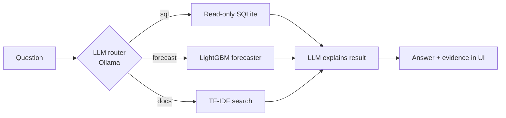

# 📦 Inventory Copilot

A local-first AI assistant that answers inventory questions in plain English. Ask about stock and sales, get a demand forecast, or look up company policy. It picks the right tool, runs it, and shows its evidence.

> Everything runs on your machine with [Ollama](https://ollama.com). No API keys. All data and policies are **synthetic**.

## What it does

| Ask | Tool | How it works |
|---|---|---|
| "Which products are below their reorder level?" | **Text-to-SQL** | LLM writes a SELECT, guarded and run on a read-only database; one self-repair retry on SQL errors |
| "Will Earbuds run out in the next 2 weeks?" | **Demand forecast** | Per-product LightGBM (Poisson objective, lag features), recursive forecast, stock-out vs. supplier lead time |
| "Who approves emergency purchase orders?" | **Policy search (RAG)** | TF-IDF retrieval over policy documents |

## Architecture



## Quickstart

```bash
pip install -r requirements.txt
python -m data.make_data                 # builds data/inventory.db
ollama pull llama3.1:8b                  # any local model works: MODEL=<name>
streamlit run streamlit_app.py
```

## Evaluation (the part that makes this more than a demo)

**1. Agent accuracy** - 20 labelled questions (12 SQL, 4 forecast, 4 policy). SQL is scored by *execution accuracy* (same rows as a gold query), not text match.

```bash
python -m eval.run_eval      # prints routing + answer accuracy per tool, writes eval/results.md
```

**2. Forecaster vs. naive baseline** - last 14 known days held out, compared with a 28-day average:

```bash
python -m eval.forecast_bench
```

On the synthetic data: LightGBM MAE **2.74** vs. naive **3.08**, better on **81%** of the 32 products. The data has built-in weekly seasonality, so expect a smaller gap on real data.

**3. Tests** - `pytest` (17 tests): SQL guard blocks writes, markdown fence stripping, database is read-only, forecast sanity, retrieval hits the right policy file, JSON parsing resilience, and the full eval pipeline scores 100% with a perfect stand-in LLM, so any score drop comes from the model, not the plumbing.

<!-- After running eval.run_eval with your model, paste the table here:
| tool | routing acc | answer acc | -->

## Design decisions

- **Read-only twice**: a regex guard (single `SELECT` only) *and* a read-only SQLite connection.
- **Show the evidence**: the UI exposes the SQL or tool arguments and raw result behind every answer.
- **Honest forecasting**: every forecast reports its own holdout error next to a naive baseline.
- **Plain router, not a framework**: one JSON-routing step keeps the control flow readable and testable.

## Limitations

- Synthetic data; single-turn questions only; answer quality depends on the local model size.
- TF-IDF retrieval matches keywords, not meaning.

## Roadmap

- [ ] Embedding retrieval (Ollama `nomic-embed-text`) and compare against TF-IDF in the eval
- [ ] Multi-turn memory ("and what about Chargers?")
- [ ] Move the router to LangGraph for multi-step questions
- [ ] Dockerfile and CI running `pytest`

## Layout

```
app/        llm.py (Ollama), tools.py (SQL/forecast/docs), agent.py (router)
data/       make_data.py (synthetic database generator)
docs/       sample policy documents
eval/       questions.json, run_eval.py, forecast_bench.py
tests/      pytest suite
streamlit_app.py
```
