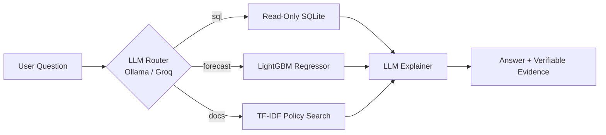

# Inventory Copilot

An autonomous, multi-tool inventory assistant that answers stock, sales, forecasting, and policy questions with verifiable evidence. Built with a local-first architecture and cloud-fallback capabilities.

---

## Architecture

Think of a shop manager directing three specialized assistants:
- The Clerk (SQL Tool): Queries database records (stock levels, historical sales, revenues).
- The Planner (ML Forecaster): Runs recursive LightGBM models to predict demand and prevent stockouts.
- The Librarian (Policy RAG): Retrieves relevant company rules, return policies, and supplier terms.



---

## Engineering Challenges and Solutions

### 1. Fragile LLM JSON Tool Calling
- The Problem: Local models often wrap JSON or SQL in markdown code blocks or return string arguments instead of structured dictionaries, causing parser failures.
- The Solution: Built a resilient parser and input normalizer in app/agent.py that strips code fences, extracts outer JSON braces, and coerces arguments into uniform schemas across all tools.

### 2. SQL Safety and Write Protection
- The Problem: LLM-generated SQL can accidentally execute destructive statements or perform modifications.
- The Solution: Implemented a two-tier defense:
  1. A strict regex guard permitting only single read-only SELECT and WITH statements.
  2. SQLite connection opened with URI mode=ro (read-only at the database engine level).
  3. Self-repair loop: if a query fails, the model receives the exact SQL error for one auto-correction attempt.

### 3. Untrusted Demand Forecasting
- The Problem: Simple moving averages fail to capture weekly seasonality, and pure LLM reasoning hallucinates inventory quantities.
- The Solution: Engineered recursive LightGBM Poisson regression with lag features (t-1, t-7, t-14, 7-day average, 28-day average, day of week). Every forecast is validated against an honest 14-day holdout set compared against a 28-day naive baseline (LightGBM beats baseline on 81% of products, MAE 2.74 vs 3.08).

### 4. Windows Platform Encoding Failures
- The Problem: Default Python file operations on Windows use system codepages (cp1252), which crashed when reading markdown policy documents containing non-ASCII characters.
- The Solution: Enforced explicit UTF-8 encoding pipelines across document loaders, evaluation harnesses, and output writers.

### 5. Cloud Hosting Without Local GPUs
- The Problem: Streamlit Community Cloud and free hosting tiers cannot run local Ollama models or large LLM weights in memory.
- The Solution: Engineered a multi-backend LLM client in app/llm.py:
  - Local environment: Automatically detects and runs private Ollama (llama3.2:3b).
  - Deployed environment: Automatically falls back to high-speed Groq Cloud API (openai/gpt-oss-120b).

---

## Evaluation and Verification

- 17 Automated Unit Tests: Passing 100% in under 1 second (pytest tests/test_copilot.py).
- Agent Evaluation Harness: 20 benchmark questions scored by execution accuracy against gold queries.
- ML Benchmark: eval.forecast_bench verifies machine learning superiority over naive baselines.

---

## Quickstart

### Local Setup
```bash
# 1. Install dependencies
pip install -r requirements.txt

# 2. Build the synthetic database
python -m data.make_data

# 3. Start Ollama and pull model
ollama serve
ollama pull llama3.2:3b

# 4. Launch Streamlit UI
streamlit run streamlit_app.py
```

### Running Tests
```bash
pytest                                # Run all 17 unit tests
python -m eval.forecast_bench         # Run ML benchmark
python -m eval.run_eval               # Run 20-question agent evaluation
```

---

## Tech Stack

- Frontend: Streamlit (Minimalist Monochrome UI)
- Agent Router: Local Ollama (llama3.2:3b) / Groq Cloud
- Database: SQLite (Read-Only guarded connection)
- Forecasting: LightGBM, NumPy, Pandas (Poisson objective)
- Document Retrieval: Scikit-learn (TF-IDF, Cosine Similarity)
- Testing: Pytest
